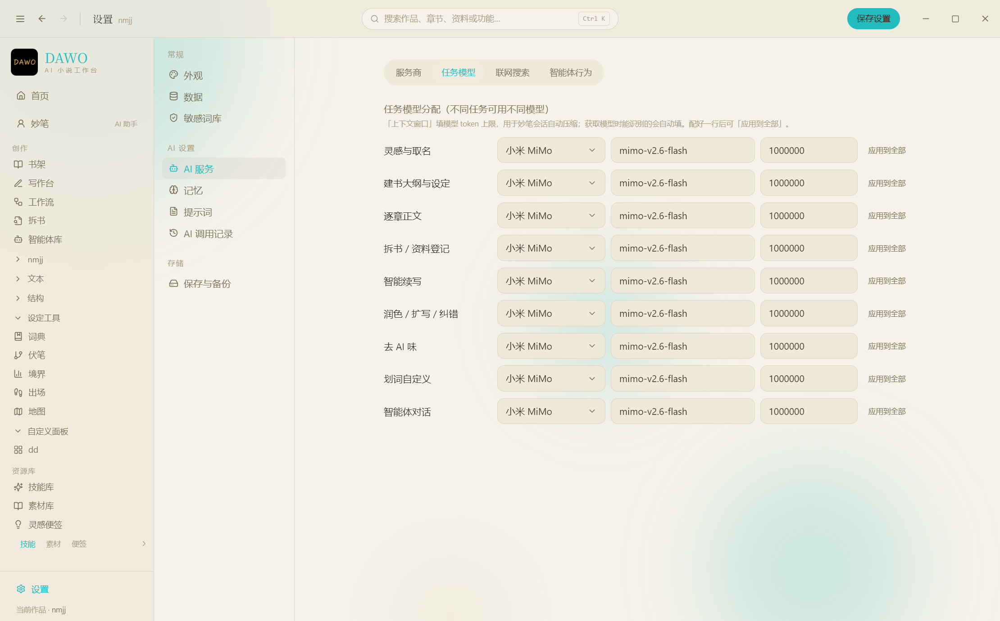
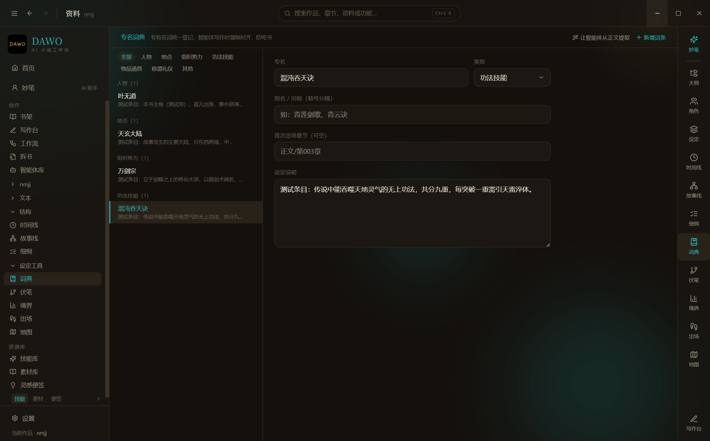
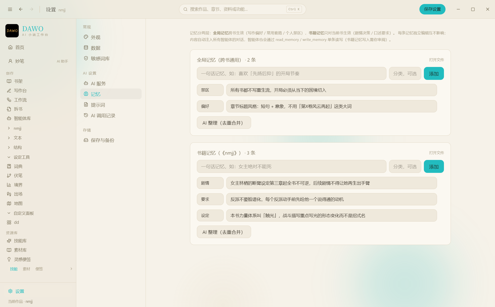
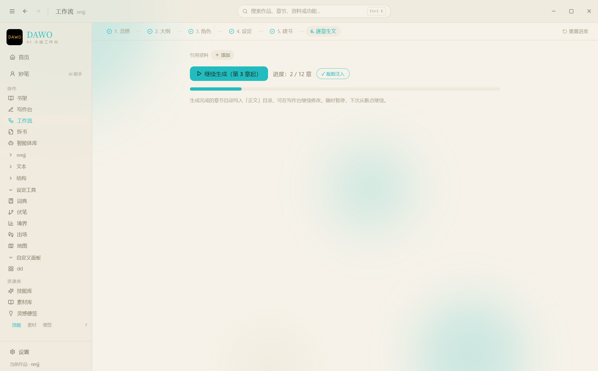
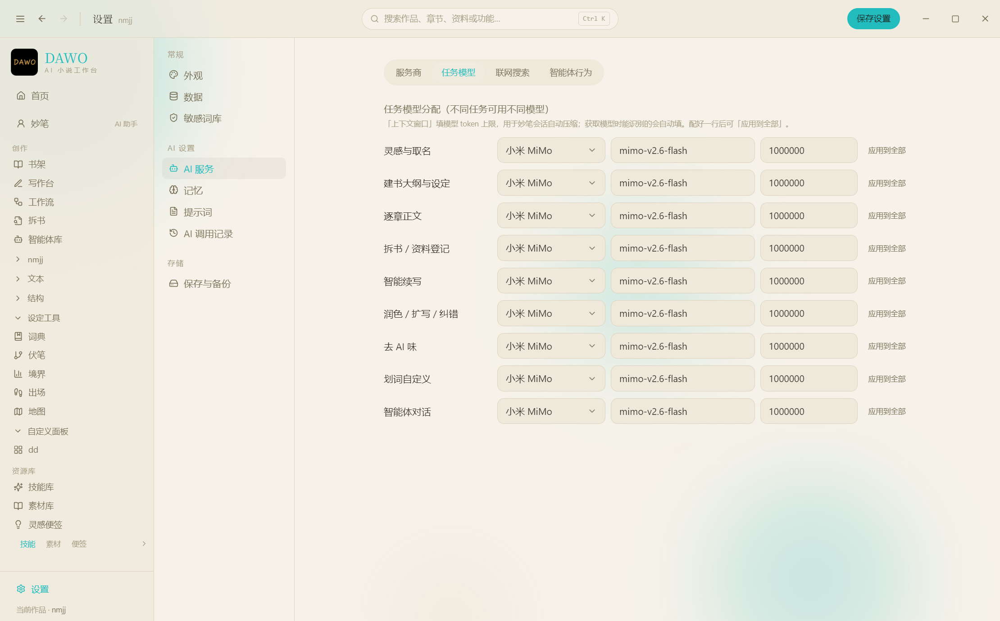
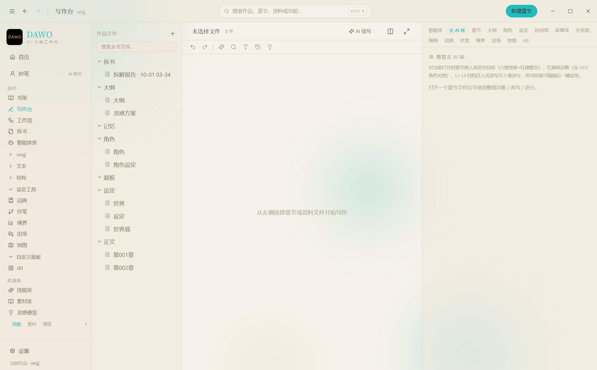
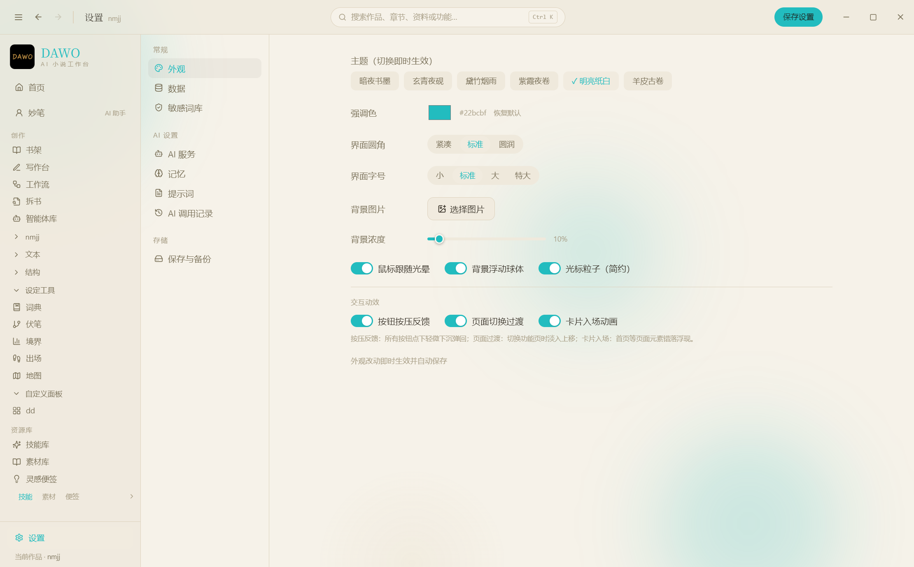

# DAWO

一款免费、本地优先的长篇网文写作桌面软件。整合工作流式逐章生成、九大结构化资料板块、可审阅的智能体系统与去 AI 味工具链，面向十万字以上的长篇创作。

> 无账号 · 无云端 · 无广告 —— 所有数据都是你磁盘上的 Markdown 和 JSON 文件。



## 快速上手

1. 从 [Releases](../../releases) 下载 `DAWO Setup x.x.x.exe` 安装（未签名，SmartScreen 拦截时选「仍要运行」）
2. 打开「设置 → AI 服务」，添加任意 OpenAI 兼容服务商并填入 API Key（Key 只存本机 `%APPDATA%\inkdesk`，不经过任何中间服务器）
3. 书架页点「AI 一键建书」：填书名、题材、平台、视角、目标读者，AI 生成简介后落笔
4. 左栏「资料」开始攒设定，或直接进「工作流」从一句话跑全流程
5. 写完想检查 AI 味？写作台右栏「去 AI 味」面板，六维打分器实时自检

## 功能详解

### 资料区：九大结构化板块 + 自定义面板

每个板块都是结构化数据（不是散落的文档），配套专用智能体与读写工具，被全局搜索索引，写作台右栏随写随查：

| 板块 | 管什么 |
|---|---|
| 时间线 | 事件排序、主线支线、多章节绑定，配套提取/补全/矛盾检测 |
| 故事线 | 节点-连线画布，七种节点类型写因果 |
| 角色关系图 | 五种关系类型（亲情/爱情/友情/敌对/其他），可从角色卡一键生成 |
| 卷/章细纲 | 每章一句话细纲 + 完成状态，支持全文存档（见工作流） |
| 专名词典 | 全书专有名词只有一个写法：词条、别名、类别、首次出场 |
| 伏笔登记 | 埋设章节、计划回收点、状态；悬置的排最前，逐章生文时整板注入硬约束 |
| 境界体系 | 境界阶梯 + 越级规则 + 角色当前境界，防战力崩坏 |
| 出场追踪 | 状态/最近出场/所在地五元组，防神隐、防死人复活 |
| 地图路线图 | 多地图多标签，AI 示意底图与节点共用世界坐标 |

不够用？资料区「添加」按钮两步向导自建专属面板：起名、定义字段（文本/数字/状态/日期），数据存在书里跟着书走。智能体可读写自定义面板（写入走提案制），创建智能体时可逐面板授权。



### 智能体系统：可审阅，可协作

- **十五个内置智能体**：大纲、人物、剧情、正文专家、分节写手、设定、时间线、故事线、伏笔管理、境界体系、出场追踪、地图、拆书、资源管家、通用助手
- **提案制写入**：AI 对资料的所有修改先出差异预览卡，你点了才落库；增量合并——AI 漏传的数据不会被清掉；冲突检测防止覆盖较新内容
- **自定义智能体**：一句话描述职责，AI 起草完整定义；目录、结构化板块、自定义面板、联网、任务分配五类权限逐项勾选
- **多智能体协作**：圆桌接力（按顺序互相补位挑刺）与分配模式（协调者派发子任务并行执行，子任务同样过审阅）
- **上下文压缩**：长对话逼近窗口阈值自动摘要压缩，保结论删过程、永远保尾部原文
- **作者记忆**：全局记忆（跨书偏好禁区）+ 书籍记忆（本本剧情决策）条目式存储；智能体开口前先读，也能自己写记忆（出审阅卡），一键 AI 整理



### 创作工作流：从一句话到三百章

流程：AI 一键建书 → 生成设定集 → 分卷大纲 → 逐章生文。长篇专门做了：

- **保守裁剪注入**：大纲按当前卷切，角色卡按出场切（词典匹配 + 主角强制保留 + 多级回退），token 成本与幻觉率一起降
- **伏笔硬约束**：悬置伏笔整板注入正文提示词，计划回收的必须回收
- **细纲全文存档**：智能体或工作流生成的完整细纲自动存进细纲板；逐章生文检测到存档直接采用，不再重新构思、不覆盖你的版本
- **字数估章数**：填预估总字数与单章字数，章节数自动算出（上限 2000 章）
- **稳定性**：推理模型思考期实时显示（不误判假死），60 秒无输出提示 / 150 秒自动中止，失败章节不当完整章落盘
- **自动登记**：建书后资料登记员把大纲设定提取进词典、境界、关系图；每章写完增量登记新专名



### 任务九通道：按任务分账

灵感取名、建书大纲、逐章正文、拆书登记、智能续写、润色、去 AI 味、划词、智能体对话——九条通道各配各的服务商与模型。大纲用好模型，三百章正文换便宜的；「应用到全部」一键铺配置，老配置升级自动继承。服务商卡片标注「正在服务」哪些任务，删除前确认并清点。



### 去 AI 味：打分在本地，预防在生成端

- **两套文体规则**：小说正文管叙述者越位、对话占比、句长落差（对话行不计入句长均值）；文章管机械连接词、科普腔、自问自答
- **六维打分器**：具体性 / 爆发度 / 疑虑 / 口语 / 离题 / 不完美，本地实时算分零 token，弱项直接给补法
- **词库外置**：判词存本地 JSON，设置里一键编辑，你觉得哪个词该进红牌自己加
- **三级诊断 + 四档改写**：22 种 AI 指纹分三级，L1-L4 改写强度，L4 注入具体细节、立场判断与允许一处不完美
- **生成端预防**：逐章生文与 AI 续写的提示词禁用高危句式、强制句长落差，首检就能过



### 拆书

贴文本或直接导入 TXT/MD（GBK 等编码自动探测），按维度拆解：结构与卷章、黄金三章、节奏与爽点、人物设计、可复用套路，也支持自定义维度。章数五档精细度——5 章精拆，30 章也能拆。结论必须附原文证据；报告自动存本书目录并沉淀进素材库，可复用套路一键提炼成技能条目。

### 资源库与全局搜索

- **资源库**：技能库 / 素材库 / 灵感便签三库，预置 26 条内容（黄金三章、三幕式、朱雀对抗手册、桥段库、钩子金句等），全部 Markdown 可改可删；资源管家能起草、改写、整理、体检
- **全局搜索**：Ctrl+K 唤起，作品、功能、文稿、资源库、结构化板块、自定义面板条目全量索引，AI 改动落盘后索引自动重建

### 外观

六套书墨风主题（墨韵深棕 / 玄青夜砚 / 黛竹烟雨 / 紫霞夜卷 / 羊皮古卷 / 素宣日课），强调色可调带恢复默认，圆角三档、字号四档，本地背景图浓度滑杆，按压波纹 / 卡片浮升 / 页面淡入 / 浮动球体动效全开关。



## 数据与隐私

- 每本书一个文件夹：正文 Markdown、资料 JSON，无锁定格式，删软件文件还在
- AI Key 只存本机配置文件，请求直连你配的服务商
- 每一次 AI 调用的功能、模型、耗时、token 估算全部可查
- 正文大改动自动历史快照，可浏览可恢复；支持整书打包备份
- 所有写入（含 AI 提案）带冲突检测与快照守卫，不会静默覆盖

一本书的目录长这样：

```
我的书/
├── book.json            # 书籍元信息
├── 正文/                # 第001章.md、第002章.md…
├── 大纲/                # 故事大纲、分卷方案
├── 角色/                # 角色卡、角色设定
├── 设定/                # 世界观、设定文档（分组自定）
├── 拆书/                # 拆书报告
├── 记忆/记忆.json        # 本书剧情决策
└── 细纲.json            # 卷章细纲（含全文存档）
```

## 常见问题

**老版本怎么升级？** 直接下载新版覆盖安装，书稿、配置、记忆自动保留（旧格式自动迁移并留 .bak 备份）。

**换电脑怎么迁移？** 拷两样东西：书架文件夹（设置里能看到路径）和 `%APPDATA%\inkdesk`（配置、全局记忆、词库）。

**支持哪些模型？** 任意 OpenAI 兼容接口：DeepSeek、Kimi、智谱、通义、小米 MiMo、OpenAI，以及 Ollama 本地模型。逐章正文建议配性价比模型。

**生成的正文会直接写盘吗？** 会——工作流对正文是「已生成即写盘」语义，但失败/中断的章节一律不当完整章落盘；已有内容的章节跳过不覆盖，手工润色稿安全。

**为什么安装时被 Windows 拦？** 安装包未做付费代码签名，属正常现象，选「更多信息 → 仍要运行」。

## 技术栈与开发

Electron 33 · electron-vite 2 · Vue 3 + TypeScript + Pinia · Tailwind 4 · TipTap 2 · vue-flow

```bash
npm install
npm run dev     # 开发
npm run dist    # 打包 Windows 安装包（建议先设置 Electron 镜像）
```

三十多份系统提示词全部落在本地 `prompts` 目录，设置里逐篇可视化编辑——AI 怎么工作，决定权在你。

## License

暂未开源授权，发布前请勿二次分发。
